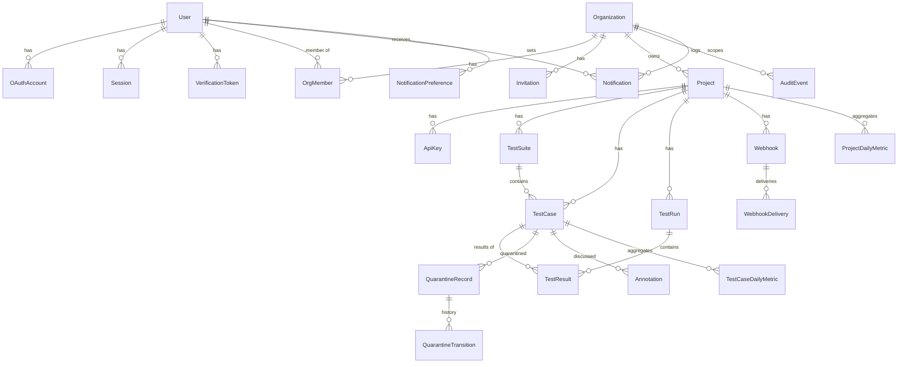

# Database Schema (Design)

> **Sprint:** P01-S03 (design) → implemented incrementally (P02-S03, P03, P04-S01, P06, P07, P08). Canonical entity list: master plan §5. This document adds relationships, constraints, cascade rules, and the isolation classification. Prisma 7.10 / PostgreSQL 16 (ADR-004).
> **Query plans** for the key queries are recorded here in P04-S01 from real `EXPLAIN ANALYZE` output. Do not add plans that were not measured.

## 1. Entity-relationship diagram

## 2. Isolation classification

| Class | Tables | Tenant key(s) | Access path |
| :--- | :--- | :--- | :--- |
| Global (identity) | `User`, `OAuthAccount`, `Session`, `VerificationToken` | — (scoped by `userId`) | `systemDb` inside the auth modules only |
| Org-scoped | `Organization`¹, `OrgMember`, `Invitation`, `Project`, `AuditEvent`, `Notification`² | `orgId` | `createTenantDb({ orgId })` |
| Project-scoped | `ApiKey`, `TestSuite`, `TestCase`, `TestRun`, `TestResult`, `QuarantineRecord`, `QuarantineTransition`, `Annotation`, `Webhook`, `WebhookDelivery`, `ProjectDailyMetric`, `TestCaseDailyMetric`, `NotificationPreference`³ | `projectId` (+ `orgId` via project) | `createTenantDb({ orgId, projectId })` |

¹ `Organization` is looked up by membership, never by a raw ID from the client alone.
² `Notification` is additionally filtered by `userId = current user`.
³ `NotificationPreference.projectId` is nullable (null = global for the user). It is filtered by `userId`, plus a membership check on `projectId`.

All `systemDb` reads and pre-tenant lookups (`ApiKey` lookup by `keyHash`, `resolveProject` by caller `userId`, `OrgService.create` / `listForUser`, `InvitationService.accept`, and `sweepSoftDeletedTenants` discovery) follow [ADR-006](../architecture/adr-006-tenant-isolation.md) and are audited statically by `[SC-SEC-004]`.

Use the project-scoped `testRun`, `testSuite`, `testCase`, and `testResult` delegates for execution data. The scoped client blocks reverse-collection operations, including nested filters, counts, and mutations. Select individual relation counts explicitly. Execution rows get their project from the tenant context and keep that project on updates. PostgreSQL also enforces same-project links from case to suite and from result to run and case through composite foreign keys. Project-scoped parent deletions affect only the bound project. Organization-wide purges use an organization context.

## 3. Constraints & indexes

| Table | Unique | Indexes | Notes |
| :--- | :--- | :--- | :--- |
| `User` | `email` (lower-cased on write) | — | `deletedAt` = anonymized |
| `OAuthAccount` | `(provider, providerAccountId)` | `userId` | |
| `Session` | `refreshTokenHash` | `(userId, revokedAt)`, `familyId` | |
| `VerificationToken` | `tokenHash` | `(userId, type)` | Deleted after use or expiry (cleanup job) |
| `Organization` | `slug` | — | `deletedAt` for soft delete |
| `OrgMember` | `(orgId, userId)` | `userId` | Exactly one OWNER per org (enforced in the service and a partial unique index `WHERE role = 'OWNER'`) |
| `Invitation` | `tokenHash` | `(orgId, email)` | Partial unique `(orgId, email) WHERE acceptedAt IS NULL AND revokedAt IS NULL` |
| `Project` | `(orgId, slug)` | `orgId` | `runCounter` incremented atomically |
| `ApiKey` | `keyHash` | `(projectId, revokedAt)` | `prefix` for display |
| `TestSuite` | `(projectId, filePath)` | — | |
| `TestCase` | `(projectId, identifier)` | `(projectId, flakyState)`, `(projectId, isQuarantined)`, `suiteId`, trigram on `title` (if chosen in P04-S04) | |
| `TestRun` | `(projectId, runNumber)`, `(projectId, externalRunId)` | `(projectId, createdAt)`, `(projectId, branch, createdAt)`, `(status, lastActivityAt)` | |
| `TestResult` | `(runId, testCaseId)` | `(runId, status)`, `(testCaseId, createdAt)`, `(projectId, createdAt)` | Highest-volume table |
| `QuarantineRecord` | partial `(testCaseId) WHERE status IN ('ACTIVE','INVESTIGATING')` | `(projectId, status)`, `(status, slaDueAt)` | Partial index created in raw SQL migration |
| `QuarantineTransition` | — | `(quarantineId, createdAt)` | Append-only |
| `Annotation` | — | `(testCaseId, createdAt)` | Soft delete |
| `Notification` | `(userId, dedupeKey)` | `(userId, readAt, createdAt)` | `dedupeKey = eventId:type` |
| `NotificationPreference` | `(userId, projectId, eventType)` | — | |
| `Webhook` | — | `projectId` | `secretCiphertext` (AES-256-GCM) |
| `WebhookDelivery` | `(webhookId, eventId, attempt)` | `(webhookId, createdAt)` | 30-day retention |
| `AuditEvent` | — | `(orgId, createdAt)` | Append-only |
| `ProjectDailyMetric` | `(projectId, date, branch)` | — | `branch = '*'` row for the all-branches total |
| `TestCaseDailyMetric` | `(testCaseId, date)` | `(projectId, date)` | |

## 4. Additional run fields (from PRD §6 and the ingestion contract)

S-010 adds `TestRun` and `RunStatus` through an additive migration. The PostgreSQL acceptance suite exercises the migration on a clean database and on Phase 03 rows, checks the three run indexes and both project-local unique keys, and verifies the hard-delete cascade. `runnerVersion` is optional and preserves the runner metadata supplied by the ingestion contract.

S-011 adds `TestSuite`, `TestCase`, `TestResult`, `ResultStatus`, and `FlakyState`. The migration adds unique `(projectId, id)` keys on each referenced execution parent to support the composite foreign keys. The PostgreSQL suites cover upgrades with existing runs, identity constraints, index order, and isolated cascades. The shared fingerprint follows [ADR-007](../architecture/adr-007-ingestion-protocol.md#fingerprint-test-identity) and reserves the NUL character for field separators.

`TestRun` stores `runner` (`playwright`/`vitest`/`other`), `reporterVersion`, `expectedTestCount` (sum over distinct shards), `quarantinedFailedCount`, and `quarantineUnblocked` (set when a reporter in non-blocking mode reports that it unblocked CI). The shard lifecycle slice will define how to store completion outcomes by shard.

## 5. Cascades & deletion

| Action | Behavior |
| :--- | :--- |
| Delete organization | Soft-delete immediately (all routes 404); an async purge job deletes projects (cascading) and then the org, in chunks |
| Delete project | Soft-delete plus async chunked purge of runs, results, cases, suites, quarantines, annotations, webhooks, and metrics |
| Delete run | Cascades to `TestResult` (only via retention; there is no user-facing run deletion in v1) |
| Retention job | Deletes `TestResult` and then empty `TestRun` rows older than the effective retention, in chunks of ≤ 5,000 rows; keeps daily metrics |
| Delete user | Anonymize (`email` → `deleted+<id>@invalid`, name cleared, sessions revoked, OAuth accounts deleted); keep authored annotations and transitions, displayed as "Deleted user" |
| Remove member | Delete the `OrgMember` row; quarantine assignments to that user are unassigned (with a transition note) |

## 6. Prisma 7 notes (ADR-004)

- `prisma.config.ts` holds the CLI datasource (`DIRECT_URL`) for `migrate deploy` and `migrate dev`. The runtime client is created with `@prisma/adapter-pg` using the pooled `DATABASE_URL`.
- Partial unique indexes and trigram indexes are written as raw SQL inside Prisma migrations.
- Bulk upserts on `TestResult` use `INSERT … ON CONFLICT ("runId","testCaseId") DO UPDATE` via `$executeRaw` with tagged-template parameters (never `$executeRawUnsafe`).
